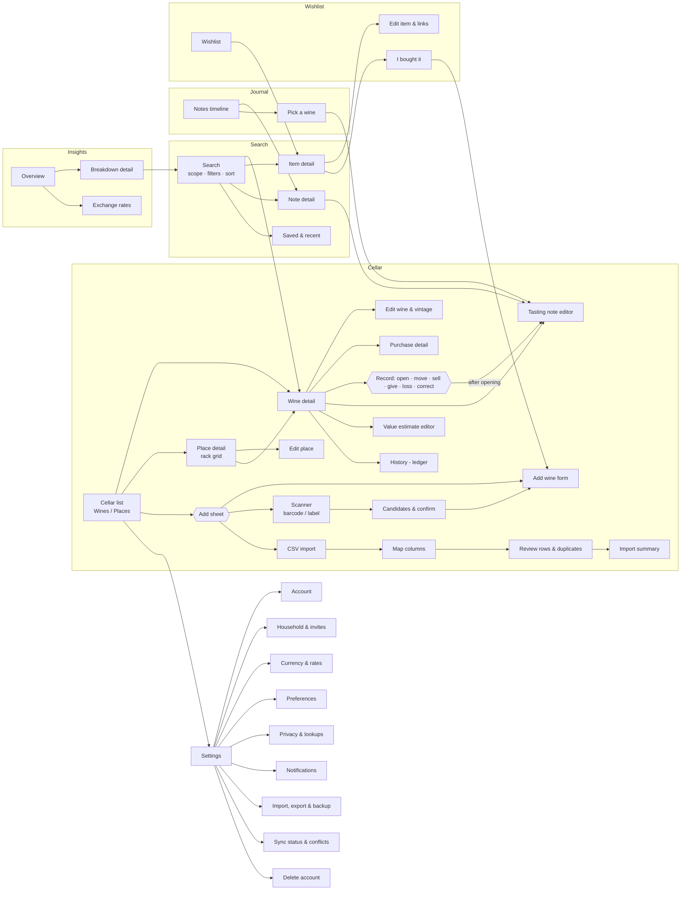

# Navigation map

Five top-level tabs. Each tab keeps its own back stack (Navigation 3); switching tabs preserves position. Phones use a bottom bar; tablets (≥ 840 dp) a navigation rail with list-detail panes.

| Tab | Purpose |
|---|---|
| **Cellar** | What I own and where it is. Home screen. |
| **Search** | Find anything across cellar, wishlist, tasting notes, and (if configured) an external catalogue. |
| **Journal** | Tasting notes, newest first. |
| **Wishlist** | Wines I want, with target prices and merchant links. |
| **Insights** | Totals, costs and values, drinking windows, consumption, breakdowns. |

Settings opens from the account button in the Cellar header. Adding (manual, barcode, label, CSV) opens from the Cellar "Add" button and from empty states.

## Screen inventory

| Screen | Route key | Arguments | Notes |
|---|---|---|---|
| Cellar list | `Cellar` | view: wines/places, sort | Vintage-column list; pull to sync; offline line |
| Wine detail | `Vintage(id)` | vintage id | Holdings by purchase × place; actions; history; notes; values |
| Edit wine | `EditVintage(id?)` | vintage id or new | Splits identity (shared by all vintages) from vintage fields; warns that identity edits affect all vintages |
| Purchase detail | `Lot(id)` | lot id | Price, source, date, case; its ledger |
| Record movement | sheet | vintage id, kind | Quantity stepper, from/to place, slot picker for gridded places, price for sales, "add a tasting note" for openings |
| History | `History(vintageId?)` | optional filter | Ledger with reversals shown as such; "Undo" = reversal |
| Place detail | `Place(id)` | location id | Contents, child places, grid with positions |
| Edit place | `EditPlace(id?)` | | Kind, name, parent, optional grid |
| Add sheet | sheet | | Manual · Scan barcode · Scan label · Import CSV |
| Add wine form | `AddWine(prefill?)` | prefill from scan/wishlist | Fast entry: producer autocomplete, vintage chips, quantity, size, place, price; "Save and add another" |
| Scanner | `Scan(mode)` | barcode/label | Camera with permission states; result confidence per field; always editable |
| Candidates | `ScanResult` | | Matches from own data first; "None of these" → form |
| CSV import | `Import` → `ImportMap` → `ImportReview` → `ImportDone` | file | Column mapping with guesses; row errors; duplicate decisions; transactional commit per batch |
| Search | `Search(query?)` | optional saved query | Scope tabs, filter sheet, sort menu, grid/list toggle |
| Journal | `Journal` | | Timeline; filter by rating/date/occasion |
| Tasting note | `Note(id)` / `EditNote(id?, vintageId?)` | | Structured + free text, photos, occasion, pairing |
| Wishlist | `Wishlist` | | Grouped by priority; status filter |
| Wishlist item | `WishItem(id)` / `EditWishItem(id?)` | | Links with last-seen prices; "I bought it" |
| Insights | `Insights` | | Totals per currency and converted (with rates shown); window counts; breakdown lists |
| Settings (+ subpages) | `Settings/...` | | |

## Deep links

- `houseofvino://vintage/{id}` — wine detail (also used by notifications: "3 wines enter their window this month").
- `houseofvino://invite/{code}` — accept a household invite after sign-in.

## Back behaviour

- System back pops the current tab's stack; at a tab root it goes to Cellar; at Cellar root it leaves the app.
- Sheets and dialogs close first. Unsaved form edits ask before discarding.
