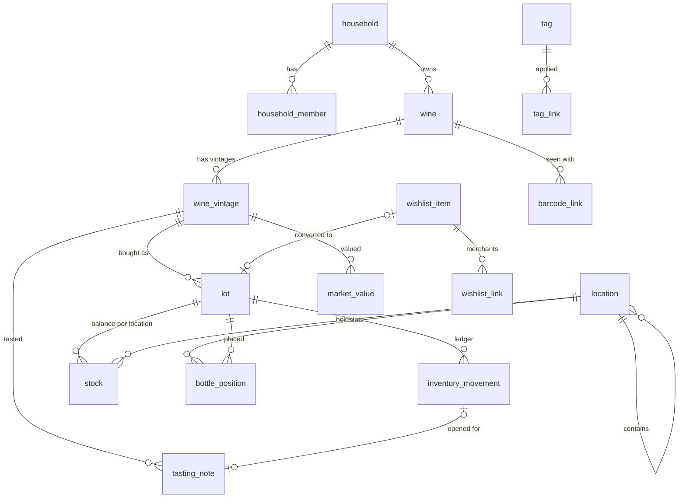

# Database schema

Two databases hold the same records:

- **On the device:** SQLite (bundled), defined by `shared/data/src/commonMain/sqldelight/migrations/*.sqm`.
- **In the cloud:** Supabase Postgres, defined by `supabase/migrations/*.sql`.

The device database is a superset: it adds device-only tables (outbox, cursors, conflicts, recent queries, search index) and device-only columns (photo file paths, movement sync state).

## Entities

| Table | Purpose | Key rules |
|---|---|---|
| `household` | A shared collection. Every user starts with one. | Membership decides visibility of everything below. |
| `household_member` | User ↔ household with role `owner` / `editor` / `viewer`. | Server-managed; read-only on the device. At least one owner. |
| `wine` | Identity: producer, cuvée name, style, country/region/sub-region/appellation, classification, grapes (JSON array), notes. | `identity_key` (folded producer + name) drives duplicate suggestions. |
| `wine_vintage` | One vintage of a wine: `year`, `nv` or `unknown`; ABV; drinking window with its source. | A check ties `vintage_kind='year'` to a non-null year. Different vintages are never merged automatically. |
| `lot` | An acquisition batch: vintage, bottle size (ml), quantity acquired, unit price + currency, extra costs, date, source, order ref, case type/size, wishlist origin. | Prices are integer minor units with a currency. |
| `inventory_movement` | Append-only ledger: `purchase`, `receive`, `adjust_in`, `consume`, `sell`, `gift_out`, `loss`, `adjust_out`, `transfer`, `reversal`. Quantity > 0, from and/or to location, occurred/recorded times, who/which device, optional price and counterparty, `reverses_id`. | Triggers block updates to ledger fields and deletes. Reversals swap locations and reference the original; a movement can be reversed once; reversals can't be reversed. |
| `stock` | Balance per (lot, location): `confirmed_qty` (accepted by the server) and `pending_delta` (local, not yet accepted). | `confirmed_qty >= 0`. Recording a movement checks `confirmed_qty + pending_delta >= quantity` at the source. |
| `location` | Tree of sites, rooms, fridges, racks, shelves, bins, cases, off-site storage. Optional grid (rows × cols). | No self-parent; cycles prevented in the repository. |
| `bottle_position` | Optional exact slot of one bottle in a gridded location. | One bottle per slot (partial unique index). Positions for a lot at a location never exceed its balance. |
| `tasting_note` | Date, author, rating (value + scale, normalised to 0–100 for sorting), structured notes (appearance, nose, palate, finish, conclusion), 1–5 scales (sweetness, acidity, tannin, body, intensity), aromas, free text, occasion, companions, food pairing, place, would-buy-again; optional links to the lot and the consumption movement. | References the vintage, so it survives consumption, sale and deletion of stock. |
| `photo` | Label/back label/bottle/tasting/receipt photos for any record. | Cloud object at `<household>/<photo id>.jpg`; device keeps file paths and upload state. |
| `wishlist_item` | A wanted wine: linked wine/vintage or free text, vintage range, NV acceptable, size, desired quantity, target and maximum price, priority 1–3, status (`wanted`, `watching`, `ordered`, `acquired`, `dropped`). | Conversion to inventory creates wine/vintage (if needed), a lot and a purchase movement in one transaction and sets `acquired_lot_id`. |
| `wishlist_link` | Merchant links with the last price the user saw and when. | Prices are user-entered. |
| `market_value` | An estimated value for a vintage and size. | Always has amount, currency, source, date. Never generated by the app. |
| `fx_rate` | Exchange rate with date and source. | Used only when converting totals; missing rates are reported, not guessed. |
| `tag`, `tag_link` | User-defined tags on wines, vintages, lots, wishlist items, tasting notes. | |
| `barcode_link` | A GTIN seen on a bottle of a wine (optionally vintage and size). | Not unique: a scan produces candidates to confirm. |
| `saved_search` | Named query (text, scope, filters, sort as JSON). | Synced per household; `owner_id` records who saved it. |

### Device-only tables

| Table | Purpose |
|---|---|
| `app_meta` | Key/value: device id, current household, signed-in user, last full index rebuild. |
| `recent_query` | Recent searches per household and scope. |
| `search_doc`, `search_fts` | FTS5 index and its mapping to records. |
| `sync_outbox` | Pending changes, one per record (edits coalesce), plus movements and photo uploads in order. Holds the base snapshot for three-way merges, attempt count, next retry time, last error. |
| `sync_cursor` | Last pulled server revision per household and table. |
| `sync_conflict` | Edits that couldn't be merged automatically, with both versions, until the user chooses. |
| `ledger_maintenance` | Switch that lets whole-household removal clear ledger rows (leaving a household, wiping the device). |

## Column conventions

| Kind | Device (SQLite) | Cloud (Postgres) |
|---|---|---|
| Id | `TEXT` UUID (v7) | `uuid` |
| Timestamp | `INTEGER` epoch ms UTC | `timestamptz` |
| Calendar date | `TEXT` `YYYY-MM-DD` | `date` |
| Money | `*_minor INTEGER` + `*currency TEXT` | `bigint` + `char(3)` |
| Decimal (rate, ABV, rating) | `TEXT` plain decimal | `numeric` |
| Lists (grapes, aromas) | `TEXT` JSON array | `jsonb` |
| Sync | `rev INTEGER` (0 = never synced), `deleted_at`, `updated_at`, `updated_by` | `rev bigint` from a global sequence set by trigger on every insert/update |

## Invariants (enforced and tested)

1. For every lot and location: `confirmed_qty` = sum of accepted movements into it − sum out of it, and is never negative. (Device: repository + test that recomputes from the ledger. Server: `apply_inventory_movement` locks the rows and checks.)
2. Ledger rows are immutable and never deleted (device triggers; server has no update/delete grants).
3. Applying the same movement twice has no effect (primary key + idempotent server function).
4. Tasting notes, movements and lots are never removed by deleting or consuming stock.
5. Every visible cloud row belongs to a household the user is a member of (RLS, pgTAP tests per table and role).
6. Money is never stored or computed as floating point.
7. The search index matches the source tables (rebuild-and-compare test).

## Migrations

- Device: add `N.sqm` (SQLite statements that move version N → N+1). `DatabaseFactory` runs pending migrations in one transaction and refuses to open a database from a newer app version. Tests open a v1 database with data, migrate it, and check the data and the schema against a freshly created database.
- Cloud: add `supabase/migrations/<timestamp>_<name>.sql`; `supabase db push` applies them. CI applies all migrations to an empty database and runs the pgTAP suite.
- Never edit a released migration; write a new one.
